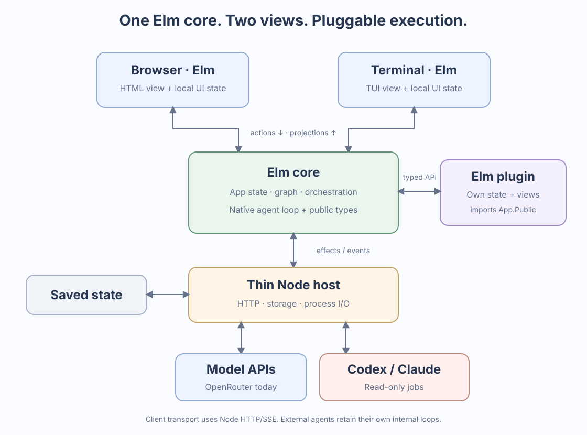

# Elm Harness: feature gaps compared with Pi

Reviewed **11 November 2026** against the live [Pi documentation](https://pi.dev/docs/latest) and this repository's current working tree, including the uncommitted permissions, accounting, compaction, and state-viewer changes. Git baseline: `b3a0ceb`.

**12 November scope update:** the user has requested other backends and Codex/Claude-style runners. Read-only Codex/Claude jobs are now implemented, superseding this snapshot's earlier deferral of external runners. See [the plugin and runner design, with architecture SVG](PLUGIN_RUNNER_DESIGN.md). Worktree writes, delegated task/join workflows and further native providers remain planned.

This is a documentation and source-code comparison, not a fresh runtime certification or an implementation commitment. Pi's `latest` documentation can change. Proposed work below must preserve the [v0.3 design](elm_harness_design_v0.3.md): Elm owns domain state, orchestration, policies, prompts, migrations, and UI semantics; Node remains an I/O adapter. OpenRouter is the initial provider, and the initial model-facing tools remain `read`, `write`, and `bash`.

**Cleanup update (12 November):** the public client projection, typed run statuses, small compiled state/view plugin, provider codec separation, save acknowledgment, and `/permissions ask` correction are now implemented. The comparison table below remains the dated audit; consult [the current design](PLUGIN_RUNNER_DESIGN.md) for implemented versus next work.

## Architecture

[Open the full-size SVG](docs/architecture.svg). The diagram includes the implemented read-only runners. The [plugin and runner design](PLUGIN_RUNNER_DESIGN.md) explains the state ownership, extension contracts, and ARIS-inspired CLI integrations.

## Main findings

The basic coding loop is present. The largest remaining workflow gaps are **delegated multi-agent tasks, isolated coding workspaces, skills and reusable prompts, a useful public extension API, and richer session/input management**.

Pi does **not** ship a built-in sub-agent coordinator. It documents sub-agents as an extension/package workflow. Its official example supports specialized agents, parallel tasks, and chains. Our harness has useful building blocks—concurrent threads, forks, captured references, and durable inboxes—but it does not yet provide that delegated workflow. [Pi's scope](https://pi.dev/#what-we-didnt-build), [official subagent example](https://github.com/earendil-works/pi/tree/main/packages/coding-agent/examples/extensions/subagent)

Current Pi also has built-in MCP integration and optional codemode/tool discovery. Descriptions of Pi as having no MCP are outdated. These are real differences, but adopting them would require an explicit scope decision for this project. [MCP documentation](https://pi.dev/docs/latest/mcp)

## What we already have

These should not be counted as missing features:

- An Elm-owned streaming model/tool loop, argument validation, cancellation, tool continuation, and concurrent thread scheduling.
- Browser and full-screen TUI clients, fixed composers, current-chat history inspection, Markdown/code rendering, and browser math rendering.
- Independent chats, forks sharing ancestry, selected-node reference delivery, and durable messages delivered at turn boundaries.
- Per-chat workspace roots, model selection, tool permissions, and estimated input budgets.
- Workspace `SYSTEM.md`, `APPEND_SYSTEM.md`, and `AGENTS.md`; effective-prompt inspection and request provenance.
- Persisted provider-reported usage/cost and model-assisted compaction with an editable preview and explicit acceptance. Original nodes remain available.
- Versioned core/user persistence, atomic saves/backups, recovery without automatically replaying interrupted tools, and a read-only JSON state explorer.

Evidence: [Core](elm/Core.elm), [server worker](elm/Server/Main.elm), [browser](elm/Main.elm), [TUI](elm/Terminal/Main.elm), [policy](elm/Policy.elm), [accounting](elm/Accounting.elm), [state viewer](elm/StateViewer.elm), and [existing implementation status](DESIGN_STATUS.md).

## Multi-agent support: present foundation, missing orchestration

The official Pi subagent **example**, rather than Pi core, launches child Pi processes with separate model contexts. It supports named agent definitions, single/parallel/chain execution, streamed progress, child cancellation, and per-task results and usage. Separate context/processes do not by themselves establish separate Git worktrees. Its documented child usage is displayed separately rather than added to the parent's session total. [Official example and limitations](https://github.com/earendil-works/pi/blob/main/packages/coding-agent/examples/extensions/subagent/README.md)

We should implement equivalent workflow semantics in Elm, using our canonical graph and scheduler. Launching Pi subprocesses or moving orchestration into JavaScript is unnecessary.

| Capability | Current harness | Missing work |
| --- | --- | --- |
| Several active agents | Multiple threads can run concurrently under a configurable limit. | No parent task coordinating those runs. |
| Delegate a task | A user can fork and send a prompt; the internal fork action also accepts initial task text. | A typed `DelegateTask` operation with task ID, parent/child ownership, purpose, and completion contract. |
| Specialist agents | Each thread has its own model, tool policy, and context budget. | Named role profiles with instructions, default model, permitted tools, and task/context policy. Workspace prompts currently apply across chats using that workspace. |
| Select child context | A fork inherits ancestry; a new chat begins independently. | Explicit choice of inherited history, selected captured references, or a fresh task-only context. Show what the child actually receives. |
| Request and reply | `Send` creates a captured handoff, queued if the recipient is busy. | Request IDs, `replyTo`, delivery/acknowledgment status, and a reply associated with the original question. A generic reference is not a typed reply. |
| Report to parent | Users can manually send findings back. | `ReportResult` with source nodes/artifacts and a durable completed/failed/cancelled task outcome. |
| Join and chains | Runs are independently scheduled. | Wait-for-all/any behavior, dependencies, sequential steps, partial failure rules, and an explicit parent continuation. |
| Task cancellation and recovery | Individual runs cancel; inboxes survive restart; interrupted tools are closed without replay. | Cancellation propagation to child tasks, task deadlines, waiting-cycle detection, and persisted task recovery decisions. |
| Progress and usage | Per-thread statuses and usage exist. | Parent task view showing children, current work, blockers, outcomes, and aggregate usage without billing inherited history twice. |
| Parallel file changes | Chats can use different existing directories; mutating tools are serialized. Forks inherit the same directory. | Harness-created Git worktrees or other isolated write scopes, base revisions, changed-path/diff inspection, and reviewed apply/merge. Serialization alone does not isolate edits. |
| Reference navigation | Source IDs and captured payloads are preserved. | Direct “open source chat/node,” request/reply navigation, and a parent/child task view. Keep the requested current-chat graph behavior. |
| Model-directed delegation | The model is offered only the three coding tools. | A deliberately designed control interface if autonomous delegation is wanted. Start with user-driven Elm actions; do not smuggle orchestration through shell commands. |

Task joins, waiting-cycle detection, and isolated write scopes are requirements from **our design**, not claims that Pi core implements them. See [v0.3 §§5.2–5.4 and milestone 3](elm_harness_design_v0.3.md). Our source evidence is the `Thread`, `Run`, `Pending`, `Fork`, `Send`, `schedule`, and `recover` definitions in [Core](elm/Core.elm), and the action decoder in [Protocol](elm/Protocol.elm).

## Other workflow gaps

**Missing** means no dedicated implementation was found. **Partial** means the building block exists but the documented workflow is incomplete. Each row links the relevant Pi reference; the local evidence map below identifies the audited modules.

| Area | Pi's documented behavior | Our gap and status |
| --- | --- | --- |
| Skills | Discovers `SKILL.md` metadata, advertises descriptions, loads full instructions on demand, and supports `/skill:name`. [Skills](https://pi.dev/docs/latest/skills) | **Missing:** skill discovery/frontmatter validation, a skill catalog in the prompt, explicit invocation, and source diagnostics. Having `AGENTS.md` is not a skills system. |
| Prompt templates | Markdown files become commands with arguments and completion. [Templates](https://pi.dev/docs/latest/prompt-templates) | **Missing:** user/project prompt libraries and expansion. Our slash commands are a fixed Elm catalog. |
| Extension API | Extensions register commands/tools/renderers, observe lifecycle events, influence context, and persist custom data. [Extensions](https://pi.dev/docs/latest/extensions) | **Partial:** `User.elm` has an independently migrated reply counter and a small string-event hook. No general typed public event/context/policy API, extension command registration, or shared UI slots. Compile-time Elm extensions should come first; dynamic loading is deferred. |
| Steering versus follow-up | Separate queues guide the next turn or wait for the run to finish. [SDK prompting semantics](https://pi.dev/docs/latest/sdk#prompting) | **Partial:** one durable inbox is flushed at turn boundaries. No explicit follow-up queue, delivery mode selection, queue inspection/edit/reorder, or restore-to-composer operation. Our Alt+Enter inserts a newline. |
| Context management | Compaction retains recent messages alongside a summary and supports threshold/overflow handling; branch summaries preserve selected work when navigating. [Compaction](https://pi.dev/docs/latest/compaction) | **Partial:** reviewed summaries exist, but replace all preceding effective conversation context. No retained-recent window, per-model capacity/output reservation, branch-summary workflow, or overflow recovery. Preserve explicit acceptance as our default. |
| Model selection and reasoning | Searchable model catalog, capability/context metadata, and supported thinking-level controls. [Models](https://pi.dev/docs/latest/models) | **Partial:** a text model ID and OpenRouter transport exist. No catalog picker, supported-capability validation, reasoning settings, or rendered/persisted thinking blocks. Catalog and reasoning support can be added within OpenRouter-only scope. |
| Transient failure recovery | Configurable retries and backoff distinguish transient model failures. [Retry settings](https://pi.dev/docs/latest/settings#network-and-retries) | **Missing:** model failures become notices; no retry lifecycle, delay policy, or retry UI. Transport reconnect in the TUI is not model-request retry. Any retry design must preserve call correlation and avoid replaying side effects. |
| File and image input | `@` file selection, path completion, image attachment, and external-editor input. [Terminal usage](https://pi.dev/docs/latest/usage#enter-a-prompt) | **Missing:** structured attachments, line-range file references, a file picker/path completion, image content blocks, and external-editor integration. Current prompts and file reads are text-only. |
| Session library | Searchable saved-session picker, clone/import, and directory-aware session selection. [Sessions](https://pi.dev/docs/latest/sessions) | **Partial:** sidebar chats and a saved workspace document exist. No searchable session library, archive/delete workflow, per-session import, or standalone clone/export. Our `/resume` starts the current chat again; Pi's `/resume` selects a saved session. |
| History navigation | `/tree` changes the active point while keeping other paths, with labels/bookmarks and filters. [Tree history](https://pi.dev/#tree-structured-shareable-history) | **Partial:** select/inspect/fork and current-chat filters exist. No bookmarks, transcript search, or return-to-earlier-prompt editing workflow. JSON state search does not search the rendered conversation. |
| Export and share | Session export and share workflows. [Session export](https://pi.dev/docs/latest/sessions#export-or-share-a-session) | **Missing:** portable per-chat Markdown/HTML/JSON export/import and deliberate transcript sharing. Copying the debug state snapshot is a different operation. Start with local export. |
| Human shell commands | `!command` includes output in context; `!!command` runs without adding it. [Shell interaction](https://pi.dev/docs/latest/usage#run-a-terminal-command) | **Missing:** direct user-command execution with an explicit include/exclude-context choice. A user currently asks the model to call `bash`. Any equivalent must retain host sandbox/policy enforcement. |
| Settings and reload | Layered user/project settings and resource reload. [Configuration](https://pi.dev/docs/latest/configuration) | **Partial:** environment options and per-thread model/policy/budget exist. No general preferences schema, configuration precedence UI, global instruction layer, ancestor instruction discovery, loaded-resource catalog, or `/reload`. |
| TUI ergonomics | Configurable named key actions, prompt history, undo/yank and richer editing. [Keybindings](https://pi.dev/docs/latest/keybindings) | **Partial:** fixed shortcuts, basic cursor editing, scrolling, and safe multiline paste exist. No keymap configuration, editor undo/history, file completion, or selectable themes. |
| Automation interfaces | Print mode and JSON event-stream CLI for scripts. [CLI](https://pi.dev/docs/latest/cli) | **Partial:** HTTP actions/state and SSE snapshots can drive clients, but there is no supported non-interactive one-shot CLI, stdin prompt input, JSONL event mode, completion exit status, or no-session mode. The terminal launcher requires a TTY. |
| Public integration protocol | RPC correlates command responses and streams lifecycle events; an SDK exposes supported session APIs. [RPC](https://pi.dev/docs/latest/rpc), [SDK](https://pi.dev/docs/latest/sdk) | **Partial:** internal versioned actions/ports exist. No public compatibility contract, per-action result/error response, granular run/tool event stream, subscription API, or embeddable Elm package boundary. An HTTP 202 does not report task completion. |
| Distribution of customizations | Packages bundle skills, prompts, themes, and extensions with versioned sources. [Packages](https://pi.dev/docs/latest/packages) | **Missing:** a harness resource manifest, discovery/enablement UI, pinned resource versions, and installation/update workflow. App npm dependencies are not user extension packages. Dynamic executable package loading remains outside current scope. |

### Integration differences requiring a scope decision

These differences should remain visible without becoming automatic implementation requirements.

| Difference | Pi reference | Decision for this harness |
| --- | --- | --- |
| Additional coding tools | Default tools include `edit`; optional tools include `grep`, `find`, `ls`, and PowerShell. [CLI tools](https://pi.dev/docs/latest/cli#tools) | Our three-tool scope is intentional. Search/listing work through bash. Consider exact-match editing only if measured whole-file write problems justify the optional fourth tool already discussed in v0.3. |
| Other providers, OAuth, and local models | Native provider authentication and compatible endpoint configuration. [Models](https://pi.dev/docs/latest/models) | OpenRouter-only is an explicit initial constraint. Do not classify absent native-provider adapters as an unfinished v1 promise. |
| MCP | Server configuration, connection state, tools/resources, exposure controls, and authentication. [MCP](https://pi.dev/docs/latest/mcp) | Entirely absent. Valuable later, but requires an approved extension/tool boundary, credential ownership, and host enforcement. Do not add an unreviewed MCP tool catalog to v1. |
| Codemode and tool discovery | JavaScript runs in a restricted interpreter to compose calls and reduce results; tool discovery avoids advertising every schema up front. [Codemode](https://pi.dev/docs/latest/codemode) | Absent and not required by v0.3. Copying its JavaScript execution model would conflict with our functional implementation goal. A future typed Elm batch/effect description could address composition without adopting Pi's interpreter. |
| Dynamic TypeScript extensions | Runtime-loaded code with lifecycle and UI access. [Extensions](https://pi.dev/docs/latest/extensions) | Deliberately use compile-time Elm modules and typed APIs first. Hot code loading is a later design question, not a reason to introduce a substantial JavaScript backend. |
| Cross-platform execution | Pi documents Windows and other environments. [Documentation platform guides](https://pi.dev/docs/latest) | Our bash sandbox currently requires Linux Bubblewrap. Broader OS support needs a real adapter/isolation design. |
| Project resource trust | Pi gates project configuration/resources but does not sandbox ordinary tool execution by default. [Security](https://pi.dev/docs/latest/security) | Our host already enforces a narrower workspace/tool boundary and explicit tool policies. We lack a persisted trust/enablement model for future executable resources. Those are separate concerns; keep existing enforcement when adding resources. |

Pi also explicitly leaves plan mode, built-in task lists, and managed background bash to extensions/files/external workflows. Their absence here is not proof of a Pi-core parity gap. Git worktree management and the durable coordinator described above are project requirements/proposals, rather than verified built-in Pi features. [Pi's stated scope](https://pi.dev/#what-we-didnt-build)

## Suggested implementation order

This ordering combines the Pi comparison with our existing design priorities. It is a proposal; none of these new items is implemented by this document.

| Order | Deliverable | Reviewable acceptance criteria |
| --- | --- | --- |
| 1 | **Isolated workspace and diff review** | An explicit fork option creates a worktree at a recorded base commit. Parent and child edits remain isolated. Both clients show changed paths/diffs and an apply/merge decision. Conflicts require resolution and original work remains recoverable. Keep ordinary conversation forks lightweight. |
| 2 | **User-driven delegated tasks** | Delegate a task to a named child/profile; inspect the child's exact initial context; observe progress; receive a referenced success/failure report; join children; and continue the parent explicitly. Cancellation and restart preserve a visible task outcome. Test independent branches, a failed child, a timed-out child, and duplicate/late replies. |
| 3 | **Public Elm extension and resource contracts** | One user-owned Elm module adds state, a typed event handler, a command, and a panel in browser/TUI without editing framework internals. Add declarative prompt templates and skill discovery. Show source/enablement diagnostics, support reload of resource data, and demonstrate independent schema migration. |
| 4 | **Long-session and input ergonomics** | Separate steering/follow-up queues; inspect/edit queued prompts; retain recent messages after reviewed compaction; add OpenRouter model metadata/reasoning controls and safe transient retries. Add file references and session search/export. Test that cancellation/retry never replays tools. |
| 5 | **Automation and optional integrations** | Stable action results/events and a scriptable one-shot/JSONL CLI. Then evaluate MCP, resource packages, additional providers, and other optional capabilities through explicit scope changes. Keep Elm responsible for orchestration and policy. |

For an immediate multi-agent increment, orders 1 and 2 are the most useful: **delegate → run in an isolated workspace when needed → report → review/join**. A collection of independently running chats alone does not provide that workflow.

### Design decisions to resolve when implementing delegation

- Whether a child inherits history, starts fresh, or receives selected references; make the selection visible and recorded.
- Whether parent continuation happens after all children, the first result, or explicit acceptance; define failure and timeout behavior.
- How child permissions are constrained by the parent, with separate estimated input limits and optional task-wide spend/turn limits. Current token accounting is observational; it is not a monetary spend cap.
- Whether autonomous delegation is advertised to the model. The existing three-tool policy does not yet define that control interface.
- How a task records its base commit, file changes, result artifact, applied revision, and rejected/conflicted merge.
- How saved task IDs, request/reply IDs, and waiting dependencies migrate and recover without restarting side effects.

## Small existing mismatch found during the audit

The README currently describes `/permissions ask` as asking for all three tools. The command actually restores `Policy.default`: **read is allowed; write and bash ask**. Resolve this by choosing the intended preset and aligning the command, help, documentation, and a regression test. This is an existing behavior/documentation mismatch, not a missing Pi feature. [Command implementation](elm/Commands.elm), [policy defaults](elm/Policy.elm), [README](README.md)

## Local evidence map

| Source | What was checked |
| --- | --- |
| [elm/Core.elm](elm/Core.elm) | Graph, thread/run fields, scheduling, inbox delivery, fork/send, summary boundaries, recovery, and absence of a typed task/dependency model. |
| [elm/Protocol.elm](elm/Protocol.elm), [elm/Commands.elm](elm/Commands.elm) | Accepted domain actions, supported command catalog, queue/control surface, and current `/resume` behavior. |
| [elm/User.elm](elm/User.elm) | Existing user namespace, migration and limited event/custom-view example. |
| [elm/Prompt.elm](elm/Prompt.elm), [elm/Server/Main.elm](elm/Server/Main.elm) | Prompt/tool construction, streamed fields, request settings, public snapshot, workspace loading, and model effects. |
| [elm/Accounting.elm](elm/Accounting.elm), [elm/Policy.elm](elm/Policy.elm) | Estimated versus reported usage, cost treatment, and per-chat permission model. |
| [elm/Main.elm](elm/Main.elm), [elm/Graph.elm](elm/Graph.elm), [elm/StateViewer.elm](elm/StateViewer.elm) | Browser controls, current-chat graph/navigation, reference inspection, and state-viewer scope. |
| [elm/Terminal/Main.elm](elm/Terminal/Main.elm), [elm/Terminal/Screen.elm](elm/Terminal/Screen.elm), [elm/Rich.elm](elm/Rich.elm) | Terminal interaction, rendering, fixed editing commands, and shared rich-content support. |
| [host/server.mjs](host/server.mjs), [host/openrouter.mjs](host/openrouter.mjs), [host/terminal.mjs](host/terminal.mjs) | HTTP/SSE transport, action acknowledgments, provider boundary, retry absence, launch options, and TTY requirement. |
| [host/tools.mjs](host/tools.mjs), [host/storage.mjs](host/storage.mjs) | Workspace/tool isolation, output/time budgets, serialized mutations, and snapshot persistence. |
| [test/session.test.mjs](test/session.test.mjs), [test/session-browser-check.mjs](test/session-browser-check.mjs), [test/terminal.test.mjs](test/terminal.test.mjs) | Existing regression coverage supporting the implemented baseline. Tests were inspected, not rerun for this documentation-only comparison. |
| [elm_harness_design_v0.3.md](elm_harness_design_v0.3.md), [DESIGN_STATUS.md](DESIGN_STATUS.md) | Agreed language/runtime/tool constraints, multi-agent milestone, shared UI contract, and deferred scope. |

## Subsequent runner increment (12 November)

Read-only Codex/Claude external jobs are now implemented, with explicit session resume, process cancellation, shared scheduling, durable launch intents, result delivery, public projections and browser/TUI controls. Tool events remain observations; external outputs are delivered to native context explicitly. CLI capabilities were checked locally and automated process/browser tests use fixtures. This does not yet supply delegated task orchestration, join/wait semantics, isolated write worktrees or additional native API providers. See [runner design](PLUGIN_RUNNER_DESIGN.md) and [usage](README.md#codex-and-claude-jobs).
