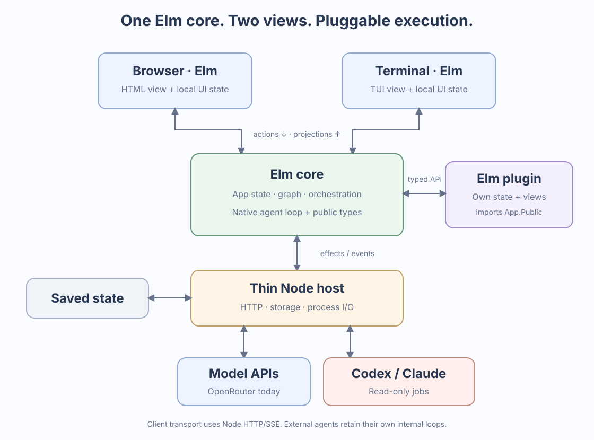

# Elm harness: a small plugin API and pluggable execution

**Updated 12 November 2026. Native foundation and read-only Codex/Claude jobs implemented.**

The core owns application rules and canonical state. A plugin owns its own state and view functions, imports shared public Elm types, and requests actions from the core. Node handles I/O. This is ordinary Elm module composition, not a dynamic plugin runtime.

## High-level architecture



[Open the SVG](docs/architecture.svg). The external-runner box represents the implemented read-only process adapters. Client arrows represent actions/projections carried through Node HTTP/SSE. Browser and terminal have local input/navigation state; the backend Elm worker owns the graph and execution state.

## How plugins use the app's type system

A plugin imports [App.Public](elm/App/Public.elm), the same contract used by the clients. It gets concrete Elm types for the readable application snapshot, threads, nodes, runs, events, and supported actions. [Run statuses](elm/App/RunStatus.elm) are a union type shared by backend and clients.

The plugin's own `Model` and `Msg` are concrete types defined in its module. They do not need to be part of `Core.Model`, or be converted to untyped JSON for each update. JSON is used at transport and persistence boundaries.

The working example is [User.elm](elm/User.elm):

```elm
import App.Public as App
import App.Ui exposing (Ui(..))
import Dict
import Json.Encode

-- This state and these messages belong to the plugin.
type alias Model =
    { showCount : Bool
    , replies : Int
    , extra : Dict.Dict String Json.Encode.Value
    }

type Msg = ToggleCount | ResetCount | StartChat

update : App.Model -> Msg -> Model -> ( Model, List App.Action )
onEvent : App.Event -> Model -> Model
sidebar : App.Model -> Model -> Ui Msg
inspector : App.Model -> Model -> Ui Msg
```

For example, `update` reads the selected public `Thread` and returns `App.NewChat title model workspace`. The backend maps that typed request to a validated core action. The plugin does not mutate the authoritative graph directly.

`onEvent` receives a typed `App.NodeCommitted node` event and counts committed assistant messages. Browser and TUI render `sidebar`/`inspector` through [App.Ui](elm/App/Ui.elm). `Ui.map` wraps plugin messages in the client's message type. The browser uses buttons; the TUI exposes the same plugin through **F6**, then **1** toggle, **2** reset, **3** new chat.

The server passes the explicitly selected chat as plugin context. Plugin actions therefore use the right workspace/model even if another client has created or selected a different chat.

### What is public and what stays internal

| Plugin can use | Core keeps ownership of |
| --- | --- |
| Public `Thread`, `Node`, `Run`, and typed `RunStatus` values | Mutable application state, graph invariants, and scheduling |
| Public committed events | Which transitions produce those events |
| Supported `App.Action` constructors | Validation and application of requested actions |
| Its own state, messages, codecs, and view functions | Core persistence and migrations |
| Shared `Ui` elements | HTML/terminal rendering and local client navigation |

These public records are read-only snapshots in the architectural sense: changing a local copy does not change backend state. Public actions are requests, not a way to bypass policy. A plugin could import implementation modules from this source tree, but that would couple it to unsupported internals. The public API is a compatibility boundary; compiled plugins remain trusted application code.

### Keep composition explicit

The current example is one ordinary `User` module wired into the backend and two clients. A second plugin can have a different `Model`/`Msg`; the application composition module stores both concrete models and wraps messages in a union. There is no need for a heterogeneous dictionary of arbitrary Elm values, runtime reflection, a package manager, or executable hot loading.

Extend the small `Ui` vocabulary and public action set when a real plugin needs another capability. Public API version 1 is the current client contract. Full-view replacement and a general extension SDK are future choices, not requirements for adding a useful panel.

## Cleanup implemented

| Boundary | Current implementation |
| --- | --- |
| App types and client views | [App.Public](elm/App/Public.elm) defines a versioned projection. Browser/TUI decode it instead of decoding saved documents into private `Core.Model`. [App.Projection](elm/App/Projection.elm) is the backend-only mapper. |
| Native context versus provider protocol | [Agent.Message](elm/Agent/Message.elm) and [Agent.Context](elm/Agent/Context.elm) describe native history without an OpenRouter request shape. [Providers.OpenRouter](elm/Providers/OpenRouter.elm) owns request encoding and response-event decoding. |
| Lifecycle | Run statuses are typed. Native model and tool launches wait for a storage acknowledgment; duplicate acknowledgments and stale/cancelled attempts do not dispatch the effect. |
| Persistence | The host acknowledges a save after atomic replacement and directory synchronization. Restart records interruption and does not replay work. A launch after a durable intent can still be interrupted before its outcome is saved; exactly-once external side effects are not promised. |
| Action results | Correlated accepted/rejected results are separate from task completion. Invalid command targets are rejected by Elm. Workspace loading also reports its asynchronous outcome through navigation results. |
| Plugin state | The existing independent `user` namespace remains compatible with v1/v2 data. Unknown plugin versions or malformed payloads are preserved and the plugin is disabled while the core remains usable. Unknown plugin data fields are retained. |
| Plugin views | The session plugin owns its counter/preferences, supplies two shared view slots, and requests a new chat through the typed public action boundary. |
| Permissions | `/permissions ask` now asks for all three native tools, matching its documentation. |

The diagnostic state explorer still includes the saved document for inspection. Normal client rendering has no dependency on that storage representation. This remains snapshot persistence, not an event-sourced storage rewrite.

## Providers and external runners

| Execution choice | Who owns its internal model/tool loop? |
| --- | --- |
| Native Elm agent using OpenRouter | Our Elm worker; implemented. |
| Native Elm agent using another model API | Our Elm worker; future provider codec/transport configuration. |
| Codex or Claude Code agent | The external program; read-only job adapter implemented. |

The user has expanded the older v0.3 scope to include other backends and runners. An external runner is not simply another API URL: it retains its own context, tools, permissions, and native session state. Our Elm core owns the product graph, delivered inputs, job/attempt lifecycle, and observed results. Delegated task/join workflows remain future work.

External tool events must be recorded as observations; they must never be executed a second time through our native tools. Native `read`/`write`/`bash` policies cannot be assumed to govern an external agent's internal tools. Each adapter must advertise supported capabilities and enforce a verified permission/isolation profile.

### What ARIS does under the hood

Reviewed [ARIS](https://github.com/wanshuiyin/Auto-claude-code-research-in-sleep) at commit `8f493923f28c3f991dcca1287db97aa780d0969b`, without running its installer or agents:

- Its [Codex bridge](https://github.com/wanshuiyin/Auto-claude-code-research-in-sleep/blob/8f493923f28c3f991dcca1287db97aa780d0969b/mcp-servers/codex-exec/server.py) exposes MCP tools, launches `codex exec` with JSONL output and stdin input, and continues through an explicit native thread ID. It remembers model/configuration, sandbox, and working directory for replies.
- Its [Claude bridge](https://github.com/wanshuiyin/Auto-claude-code-research-in-sleep/blob/8f493923f28c3f991dcca1287db97aa780d0969b/mcp-servers/claude-review/server.py) launches `claude -p` with structured JSON, parses the terminal result/session ID, and uses `--resume` for follow-ups. It restricts reviewer tools/MCP configuration and supports persisted background review jobs. CLI permission settings alone are not an OS sandbox.

We can use that structured-process/session pattern directly, without introducing their Python MCP bridge into our app. Elm constructs commands and interprets events; the existing Node host can provide process pipes and cancellation.

For bounded jobs use the documented [Codex exec interface](https://learn.chatgpt.com/docs/non-interactive-mode); evaluate [Codex app-server](https://learn.chatgpt.com/docs/app-server) for richer persistent control. Claude documents structured and token-streamed output in its [programmatic guide](https://code.claude.com/docs/en/headless). Verify installed capabilities with fixtures/probes before enabling a feature.

## Next implementation steps

1. **Read-only external jobs — implemented:** typed job/session/attempt bindings, Elm CLI specifications and normalized event codecs, host process supervision and a read-only Bubblewrap wrapper, shared concurrency, durable launch intents, cancellation/recovery, explicit reporting, and browser/TUI controls. Native OpenRouter remains the default. Installed CLI flags were probed; process and browser fixtures exercise both adapters without paid model calls. Live authenticated model smoke checks remain unperformed.
2. **Isolated writes and delegation:** create worktrees or other write scopes, then add core-owned task identities, report/join/cancel rules, and recovery. Plugins own domain workflow details such as review rounds; they request task actions instead of keeping a second task lifecycle.
3. **More providers and controls:** add verified provider codecs, richer runner controls, skills/templates, and further plugin slots as needed.

Runner tests must cover startup/transport failure, partial frames, duplicate and late events, cancellation, unsupported policies, native-session ownership, and incremental versus cumulative usage. Resume by explicit session ID, never by “last session.” Fork at a native checkpoint only when supported; otherwise label the new session as a captured-context handoff. Worktrees isolate edits, not credentials or OS access.

Read-only CLI jobs are now implemented. Task delegation/join, worktree writes, and additional native model providers remain unimplemented. The [gap analysis](PI_FEATURE_GAP_ANALYSIS.md) records the broader comparison with Pi.

## Implemented runner boundary

[Runner.elm](elm/Runner.elm) owns the job queue, attempts, session ownership, deduplication and terminal transitions. [Runner.Protocol](elm/Runner/Protocol.elm) constructs argv and interprets Codex/Claude JSON; [Runner.Types](elm/Runner/Types.elm) and [Runner.View](elm/Runner/View.elm) supply public values and shared display text. The core integrates that queue with native concurrency and graph auditing. Captured inputs are persisted; effects launch only after save acknowledgment. A vendor terminal message is provisional until its process exits successfully. Interrupted work is never replayed on restart.

[host/runners.mjs](host/runners.mjs) only probes capabilities, prepares a private CLI home, mounts the read-only process scope, frames UTF-8 JSONL, forwards events, and handles process exit/cancellation and byte/time limits. Authentication/session files stay in private runner storage outside the project. Native and external tool permissions are distinct. The normal model API network is available to external CLIs; native bash retains its network-isolated profile.

Browser **Agents** and terminal **F7** / `/agents` show current-chat jobs. Jobs start fresh sessions; follow-ups resume the recorded session only, retaining workspace/backend/model configuration. Public projections omit private captured input and stream deduplication state. Completed attempt outputs are immutable graph records; they enter native context only through explicit result delivery. Codex item updates replace snapshots, Claude token deltas reconcile with final text, and Claude cumulative session cost is never summed into native OpenRouter usage. See the [README](README.md#codex-and-claude-jobs) for commands and configuration.

Runner UI update: slash-command submission now has immediate client-owned pending feedback, and browser/TUI conversation views render active and completed external responses inline. Continuation controls beside a response resume the recorded native session. Model choices are normalized in Elm from Codex local catalog metadata and documented Claude aliases; custom IDs and CLI defaults remain supported. Private catalog metadata is excluded from projections. Cancelled/failed partial responses are recorded before another attempt can replace the transient job output.
