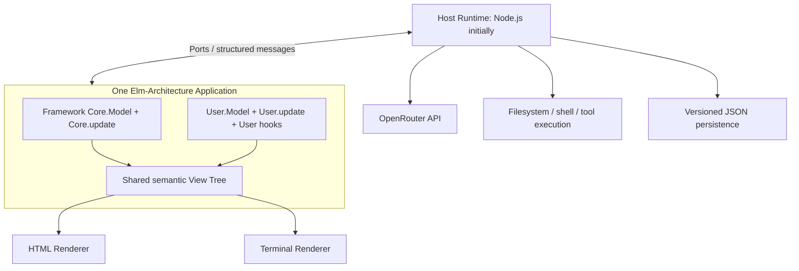
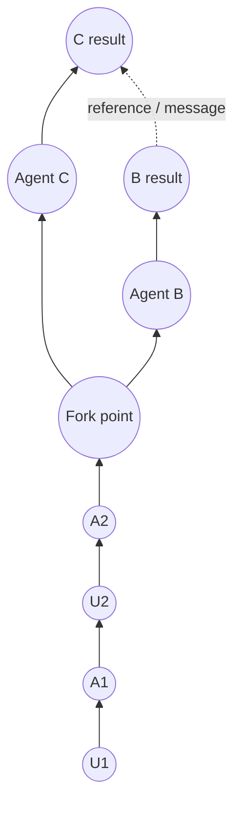

# Extensible Agent Harness Based on the Elm Architecture

**Design document · Draft v0.1 · 10 November 2026**  
**Implementation language:** undecided (Elm Architecture as the specification; Elm or Gren may be evaluated later)  
**Initial LLM provider:** **OpenRouter only**  
**Initial interfaces:** browser HTML and terminal UI (TUI) from a shared view definition

> **Primary goal:** a small, purely functional, user-customizable coding-agent harness where conversations are navigable graphs; branches can run concurrently and communicate by references; framework upgrades preserve user extensions and saved data.
>
> **Scope constraint:** do **not** implement Claude Code SDK, Codex SDK, Codex CLI, or Claude CLI runners in v1. Keep the runner boundary capable of supporting them later, without their complexity in the initial implementation.

---

## 1. Design principles

1. **Follow The Elm Architecture (TEA):** one application model, messages, a pure `update`, a pure `view`, and effect commands interpreted by a runtime.
2. **One canonical history graph:** no separate, duplicated `Chat` and `Agent` conversation histories. The graph owns messages and activities. Threads are paths/heads through it. Agents are execution identities attached to threads, not copies of chat history.
3. **Pure core, impure edge:** context construction, graph mutations, orchestration decisions, rendering descriptions, and migrations are pure. Network calls, filesystem operations, tools, and process execution happen in the host runtime.
4. **User-owned extension space:** user state, hooks, views, and migrations live separately from framework-owned code and persistence.
5. **UI is data:** one shared semantic view description, interpreted by HTML and TUI renderers. The user can add panels, change node presentations, and adjust visibility in their own code.
6. **Branching is first-class:** any committed node can be a fork point. Independent branches keep references to their origins and can explicitly communicate.
7. **Preserve causality:** committed history has stable IDs and ordering. Streaming updates are transient until finalized. Concurrency never silently overwrites or conflates events.
8. **Safe, reversible upgrades:** decode and migrate stored state before normal updates; preserve original data on failure; never silently discard unknown versions.
9. **Small initial implementation:** prove one OpenRouter-powered agent, graph UI, persistence, and user extensions before adding complex scheduling or backends.

### Explicit non-goals for v1

- No native integration with Codex CLI or Claude Code CLI.
- No provider-specific SDK as a required dependency.
- No distributed orchestration or remotely hosted multi-user service.
- No attempt to reproduce an external CLI's private conversation format.
- No elaborate plugin framework with dynamic module loading. Users edit their extension source and **recompile**.
- No requirement that the TUI reproduce every browser-only visual effect pixel-for-pixel.

---

## 2. Architecture at a glance



**Conceptual TEA signatures:**

```elm
-- Illustrative typed interfaces, not drop-in compilable code.
type alias Model =
    { core : Core.Model
    , user : User.Model
    }

type Msg
    = CoreMsg Core.Msg
    | UserMsg User.Msg

init : Flags -> ( Model, Cmd Msg )
update : Msg -> Model -> ( Model, Cmd Msg )
view : Model -> Ui Msg
subscriptions : Model -> Sub Msg
```

`Ui` is **our proposed platform-neutral UI algebra**, not a built-in Elm type. The host/runtime interprets commands but does **not** choose the next state transition.

---

## 3. One history graph, not separate chat and agent histories

### 3.1 Minimal conceptual structure

```text
Workspace
  graph: Map<NodeId, Node>
  threads: Map<ThreadId, Thread>
  runs: Map<RunId, Run>
  ui: CoreUiState

Node
  id
  parentId: Maybe NodeId       -- causal history / branch structure
  refs: List<NodeReference>    -- explicit cross-branch references
  threadId
  actor: User | Agent(runId) | Tool | System
  kind: NodeKind
  payload
  committedAt

Thread
  id
  head: Maybe NodeId
  forkedFrom: Maybe NodeId
  title
  runnerConfig               -- e.g. OpenRouter model

Run
  id
  threadId
  status
  pendingRequestId
  lastActivityAt
```

This is **one graph of messages and activities**. A thread represents an active history path, and a run represents an agent's current execution. Neither stores a second copy of messages.

A **thread is not necessarily an agent**: a thread can be paused or browsed without a runner. A run is simply an execution attached to a thread. A sidebar can label these runs as "agents" for user-facing clarity.

`parentId` is the causal predecessor in a conversation path. A branch starts with a new node whose parent points to the chosen fork node. Multiple nodes may point to the same parent. Parent edges must be acyclic.

`refs` are **semantic references** between nodes, not causal parents. They let agents share findings, ask questions, cite work, or link results across branches. The reference graph can be much richer than the ancestry graph; references never modify the original node.

### 3.2 Node kinds

Start with a small tagged union:

```text
NodeKind
  UserMessage       -- prompts, questions, instructions
  AgentMessage      -- agent's committed text response
  Activity          -- model call started/completed, context compaction, etc.
  ToolCall          -- request and input metadata
  ToolResult        -- output, success/failure, diff reference
  Approval          -- pending/allowed/denied decision
  Handoff           -- delegated request to another branch
  Summary           -- explicit compaction / handoff summary
  Notice            -- error, cancellation, lifecycle information
  Custom(tag, data) -- optional extension event, with own schema
```

A model's streaming token deltas are **not** individual graph nodes. They update a transient draft associated with the currently pending response. When the response finishes, commit one `AgentMessage` (and any appropriate tool/activity nodes). This avoids a graph with thousands of token dots.

Some lifecycle transitions can be combined into one activity record with start/end timestamps. We should choose a consistent event persistence policy, but we must preserve relevant user-visible tool actions and failures.

### 3.3 Example graph



Diagram arrows here illustrate conceptual links, **not** the final layout orientation. Persisted `parentId` and `refs` define precise semantics. The graph must not assume that a reference is itself a reply or an ancestor.

---

## 4. The graph-first UI

The graph is the main navigation surface, not an optional debug view.

### 4.1 Single-agent layout

A single thread is presented as a **vertical line of dots**, progressing **upward in time** (newer at the top by default, with a setting to reverse it). Every dot shows a short annotation above or beside it.

```text
                  NOW ↑
                   ●  Agent: "Tests passed; patch is ready"   (green bubble)
                   │
                   ◆  Tool: run tests                           (amber diamond)
                   │
                   ●  Agent: "I'll adjust the parser"          (blue bubble)
                   │
                   ◉  You: "Please fix the parser"             (white outlined circle)
                   │
                   ○  Session started                           (gray circle)
                  EARLIER
```

Legend is illustrative. Colors and icons must **both** carry meaning; no status should be conveyed by color alone. Users may override theme mappings. Important node types should remain distinguishable in monochrome terminals.

Proposed defaults:

| Node / actor | Shape or icon | Suggested style | Preview |
| --- | --- | --- | --- |
| User prompt/question | `◉`, `?` | neutral / outlined | first line of prompt |
| Agent message | `●`, chat icon | blue | first line of response |
| Tool action | `◆`, wrench icon | amber | tool name + target |
| Tool success | `✓`, check icon | green | outcome |
| Tool failure | `✕` | red | compact error |
| Branch/fork | `⑂`, fork icon | purple | destination agent/thread |
| Cross-agent message | `↗`, link icon | teal | target + brief summary |
| System notice | `○`, info icon | gray | notice |
| Pending approval | `!`, shield icon | orange | requested permission |

### 4.2 Multi-agent graph

When a thread forks, render **parallel vertical lanes** that converge on their common ancestor. Branch lines and node labels should preserve stable positions as new events arrive. Cross-agent references appear as **dashed connectors** or lightweight link markers; they must not force a tangled ancestry layout.

Desired interactions:

- Click or keyboard-select a node → open its complete message, activity details, tool arguments/results, or diff in a detail pane.
- Hover/focus → show a short preview, timestamp, agent identity, and status.
- Click a branch junction → navigate to that thread; optionally highlight just its ancestry.
- Click a cross-agent reference → highlight source and target, then follow the link.
- Filters → messages only, tools, errors, approvals, one agent, or all agents.
- Collapse adjacent low-value activity nodes into one summary marker; expanding must restore every stored item.
- Zoom/pan in browser; keyboard navigation and horizontally scrollable/condensed lane view in TUI.
- Keep a stable selection while streams append nodes; do not jump focus when the user is inspecting history.
- Include a compact **list fallback** for narrow terminals and accessibility.

**Suggested browser layout:**

```text
┌───────────────┬────────────────────────────────┬──────────────────────────┐
│ ACTIVE AGENTS │       GRAPH OF CONVERSATION    │    SELECTED NODE         │
│               │                                │                          │
│ ● Main   LLM  │      ● A ← ─ ─ ─ ● B          │ Agent B / tool result    │
│ ◆ Tests  Tool │      │           │             │ Full text / code / diff  │
│ ! Review Wait │      ●           ●             │ Timestamp / references   │
│ ○ Draft  Idle │       \         /              │ Actions / reply / fork   │
│               │        ● fork point            │                          │
├───────────────┴────────────────────────────────┴──────────────────────────┤
│ Message input / model selector / run controls                            │
└──────────────────────────────────────────────────────────────────────────┘
```

The graph should be a first-class **semantic** `Ui` primitive (e.g. `ConversationGraph GraphViewModel`) so HTML and TUI renderers can implement appropriately different geometry using the *same* graph data, selection messages, filters, and accessibility labels.

### 4.3 Active-agents sidebar

Each active or recently active **run** gets one item. Display:

- Agent / thread label, model ID, abbreviated current task.
- **State icon:** thinking/model request, using tool, waiting for approval, queued, idle, finished, paused, error.
- Small last-activity timestamp and optional progress text.
- Controls: focus, pause/cancel, resume, send message, fork, view pending approval.

Use a state machine, not mutually contradictory booleans:

```text
RunStatus = Idle | Queued | RequestingModel | Streaming
          | ExecutingTool | AwaitingApproval | Paused
          | Completed | Failed(Error) | Cancelled
```

A *run* and *thread* are distinct concepts only for execution bookkeeping; both refer to the same graph. The sidebar should be derived from the `runs` registry, not from a second agent-chat database.

---

## 5. Multi-agent branches and communication

### 5.1 Forking

A user may fork from **any committed message or activity**:

1. Select source node `N`.
2. Choose **Fork** and optionally pick a model, task, and workspace.
3. Create new thread `T2` with `forkedFrom = N`.
4. Construct the new agent's initial context from the causal ancestry ending at `N` plus an explicit fork instruction.
5. Start an independent OpenRouter run on `T2`.
6. Keep `T1`'s head and execution unchanged.

**No deep copy of history is required.** The two threads share immutable ancestor nodes; each gets separate descendants.

### 5.2 Communication between branches

Branches must be able to communicate, but **shared history does not mean automatically shared context**. A branch only sees ancestor history plus messages and references deliberately delivered to it.

Recommended operations:

```text
SendToThread(targetThread, sourceNodeRefs, message)
RequestFromThread(targetThread, question, sourceNodeRefs)
DelegateTask(parentThread, forkAtNode, task)
ReportResult(parentThread, childThread, resultNodeRef)
```

A cross-agent message creates a **new committed node on the recipient's thread**, with:

- a normal causal `parentId` pointing to the recipient thread's current head;
- `refs` pointing to source nodes in the sender's thread;
- an immutable, captured payload or summary of what was delivered;
- origin run/thread, timestamp, and delivery status.

This is crucial: a reference alone is not enough to establish exactly **what the recipient model saw at send time**. Persist the delivered text/context snapshot and provenance. Later edits or summaries in the source branch must not silently change the recipient's past input.

A user or another agent can inspect a reference, navigate to its full originating content, and optionally send follow-up questions. For v1, only explicit sends are allowed; autonomous inter-agent delegation can come later.

### 5.3 Agent-to-agent request and reply

Example:

```text
Main: "Implement the feature."
  ├── Agent B: "Investigate API design."
  │      └── B-17: API findings
  └── Agent C: "Write tests."
         └── C-22: Test findings

Agent B → Main: message with ref(B-17)
Agent C → Main: message with ref(C-22)
Main: incorporates referenced findings
```

Links appear in the graph as non-ancestry edges. The user can click B-17 or C-22 to inspect the exact source material.

### 5.4 Concurrency and determinism

- Each thread has one authoritative head pointer and serialized graph mutations.
- New commits carry an expected head/revision. On a conflict, the scheduler either queues the message or creates an explicit sibling branch, never overwrites history.
- Multiple independent threads can request OpenRouter simultaneously under configurable concurrency limits.
- Messages sent to a busy target go into a **durable recipient inbox** and are inserted at a defined boundary (e.g., after the current tool/model turn). No surprise mid-token context injection.
- Every runner request and tool call has a unique correlation ID. Late responses from cancelled or superseded requests are ignored or recorded as cancelled, never attached to the wrong thread.
- References may cross back and forth, but parent links must stay acyclic. Orchestration should include timeouts and detect simple waiting cycles to avoid deadlocks.
- Parallel coding agents should use separate Git worktrees or otherwise isolated write scopes before unrestricted concurrent editing is enabled.

---

## 6. Pure agent loop with OpenRouter only

### 6.1 One provider, small boundary

The initial backend connects **only to OpenRouter** at its documented OpenAI-compatible API. No Codex/Claude CLI runners or provider SDKs are required.

The host owns `OPENROUTER_API_KEY` and uses `POST https://openrouter.ai/api/v1/chat/completions` with streaming and tool-calling where supported by the selected model. Never put the key in browser code or persisted session history.

OpenRouter model capabilities differ. Check model metadata or handle unsupported tools/parameters rather than assuming every model supports the same features.

```text
User submits message
  → Core.update commits UserMessage
  → Core.update emits RequestModel(runId, context, tools)
  → Host sends OpenRouter request and streams results
  → Host delivers normalized events as Msg
  → Core.update advances transient draft / records tool requests
  → Host executes approved tool calls (if any)
  → Core.update commits ToolResult and requests next model step
  → Core.update commits AgentMessage and marks run idle/completed
```

**Important:** the host executes *effects*, not agent policy. The decision to call the model again, stop, request approval, or delegate should live in pure `update` logic.

### 6.2 Suggested effect protocol

```text
CoreEffect
  RequestModel(requestId, threadId, ModelRequest)
  CancelModel(requestId)
  ExecuteTool(callId, ToolSpec)
  PersistWorkspace(workspaceId, encodedDocument)
  ReadWorkspace(workspaceId)
  Notify(message)
```

```text
HostEvent
  ModelStarted(requestId)
  ModelTextDelta(requestId, text)
  ModelToolCallDelta(requestId, index, partialData)
  ModelFinished(requestId, usage, finishReason)
  ModelFailed(requestId, error)
  ToolFinished(callId, result)
  StorageFinished(operationId, result)
```

Convert external JSON into a **stable internal event representation** at the host boundary. Streaming tool arguments can arrive in fragments: buffer until complete and validate JSON and schema **before** executing any tool. A terminal usage chunk is accounting data, not a second completion.

### 6.3 Minimal tool runner

For a coding harness, plan for typed tool definitions such as:

- Read file and list directory (read-only).
- Search project files (read-only).
- Apply patch or write file (mutating; requires policy check).
- Run a bounded shell command (requires policy check and often approval).

Tool definitions, argument validation, budgets, and permission policies belong in the host/tool layer; Elm chooses when to request a tool and records its results. Apply workspace-root containment, path validation, timeouts, output limits, and cancellation. **No unrestricted shell by default.**

Start with a minimal safe tool set; adding tools should not force changing the graph model.

### 6.4 Constructing context from a graph

For a model request on thread `T`:

1. Walk causal parents from `T.head` to root, then reverse into chronological order.
2. Convert relevant user, assistant, tool-call, and tool-result nodes into OpenRouter-compatible messages.
3. Include committed inbound agent-to-agent messages and the exact delivered payload snapshots.
4. Exclude purely visual UI state and low-level activity instrumentation from model context.
5. Add the selected system instructions, tool schemas, workspace context, and user policy.
6. Enforce context budget using an explicit summary/compaction event while keeping original graph nodes intact.

**Do not include arbitrary cross-reference chains automatically**: this could lead to huge contexts and unintended information propagation. References are navigation/provenance; only explicitly delivered content enters a model's context.

---

## 7. Shared views: HTML and TUI

### 7.1 Shared semantic view tree

Conceptual type:

```text
Ui msg
  = Text(...)
  | Column(List(Ui msg))
  | Row(List(Ui msg))
  | Panel(id, Ui msg)
  | Input(value, onChange)
  | Button(label, msg)
  | Markdown(content)
  | CodeBlock(language, content)
  | ConversationGraph(GraphViewModel, GraphInteraction -> msg)
  | DetailInspector(SelectedNodeViewModel, InspectorAction -> msg)
  | AgentSidebar(List AgentItem, SidebarAction -> msg)
  | CustomRegion(slotId, Ui msg)
```

The browser renders HTML/SVG/Canvas as appropriate. The TUI renders terminal cells, lines, text and keyboard controls. `ConversationGraph` is semantic; HTML can use spatial graph geometry while a narrow TUI uses condensed lanes or a textual tree.

Both emit the **same application messages** for select, filter, fork, focus, and send. The visual renderer does not own canonical state.

### 7.2 User customization without editing framework files

Users own their implementation of:

```elm
User.init         : UserFlags -> User.Model
User.update       : User.Msg -> User.Model -> (User.Model, Cmd User.Msg)
User.onCoreEvent  : Core.PublicEventV1 -> Core.PublicViewV1 -> User.Model
                 -> (User.Model, Cmd User.Msg)
User.view         : Core.PublicViewV1 -> User.Model -> Ui User.Msg
```

(The signatures are interface proposals; the exact module/type names can be chosen later.)

The application composes the core view and user view by mapping their message types, e.g. `Ui.map CoreMsg coreView` and `Ui.map UserMsg userView`.

**Stable extension slots**, rather than editing internal core view structures, should be provided for:

- sidebar header/footer and custom agent badges;
- graph node preview, node metadata badges, legend and filters;
- detail inspector tabs and custom activity renderers;
- main input toolbar and status footer;
- optional full view replacement via a public `Core.PublicViewV1` projection.

Users can override appearance and visibility and recompile. Framework core updates must not overwrite the user files. In return, users should customize against a **public API version**, not private `Core.Model` fields.

### 7.3 Example custom extension

A user adds `showTokenCost : Bool` to `User.Model`, listens for public `UsageRecorded` events, and inserts a small cost chart into the sidebar. Nothing about core persistence or core rendering internals needs to change.

An advanced user can implement a wholly different shared view using the public graph projection. This gives extensibility without requiring unsafe source patches to the framework.

---

## 8. Backward compatibility, persistence, and migration

### 8.1 Separate schemas

**One runtime application model**, but independent saved namespaces:

```json
{
  "documentVersion": 1,
  "core": {
    "schemaVersion": 3,
    "data": { "graph": {}, "threads": {}, "settings": {} }
  },
  "user": {
    "schemaVersion": 2,
    "data": { "showTokenCost": true }
  }
}
```

The example is illustrative. Internal fields such as `Cmd`, open sockets, in-flight handles, and transient streaming buffers should **not** be serialized. Resume/recovery policy must explicitly reconstruct or mark interrupted runs.

### 8.2 Startup sequence

```text
Host reads JSON → Elm decodes stored document
   → Core migration chain (old core schema → current core schema)
   → User migration chain (old user schema → current user schema)
   → Validate both + graph invariants
   → Build runtime Model
   → Persist upgraded document safely (if changed)
   → Begin normal update/subscriptions
```

Migrations are pure functions, e.g. `User.migrateV1toV2 : OldUserData -> NewUserData`, or version-indexed JSON decoders. For simple additive fields, use decoder defaults if the old field is absent. For semantic changes, require explicit migrations.

**Key compatibility rule:** adding a new core field must not demand edits to `User.Model`; adding a user field must not demand edits to core. Public API changes are versioned (`PublicViewV1`, `PublicEventV1`) and old adapters are retained for supported compatibility periods.

An extension built against a supported public API should continue compiling when internal core records change. This guarantee does not extend to users who directly patch private core files.

### 8.3 Reliable saves

For the initial implementation, a single JSON document per workspace is adequate:

1. Prepare validated encoded data in Elm.
2. Host writes to `workspace.json.tmp`, flushes as needed, and atomically renames on the same filesystem.
3. Keep a backup of the pre-migration file until the new document is committed and loadable.
4. Serialize writes and use revisions to prevent stale writes.
5. If decoding, migration, or validation fails, preserve the original and show a recovery error.

At larger scale, replace the storage implementation with append-only JSONL nodes plus checkpoints/snapshots, without changing the public graph semantics. Do **not** prematurely commit the v1 implementation to a complex event-store stack.

### 8.4 Durable graph invariants

- Stable unique IDs for nodes, threads, runs, and requests.
- A node's causal parent exists or is `None`; ancestry is acyclic.
- A committed node is immutable (corrections are new nodes or explicit revisions).
- A thread head points to a valid node in its reachable ancestry.
- A cross-reference target is valid or is visibly marked unresolved; never silently point elsewhere.
- Tool result nodes identify the originating tool-call ID.
- User-owned persisted data is not discarded by a core upgrade.

---

## 9. Single model and message orchestration

An illustrative `Main.update` composition:

```elm
update : Msg -> Model -> ( Model, Cmd Msg )
update msg model =
    case msg of
        CoreMsg coreMsg ->
            let
                result = Core.update coreMsg model.core
                userResult =
                    User.onCoreEventBatch
                        result.publicEvents
                        (Core.publicView result.model)
                        model.user
            in
            ( { core = result.model, user = userResult.model }
            , Cmd.batch
                [ Cmd.map CoreMsg result.command
                , Cmd.map UserMsg userResult.command
                ]
            )

        UserMsg userMsg ->
            let
                ( newUser, userCmd ) = User.update userMsg model.user
            in
            ( { model | user = newUser }
            , Cmd.map UserMsg userCmd
            )
```

This sketch assumes `Core.update` returns a record with `model`, `command`, and **public committed events**. It is an interface design, not standard Elm `update` behavior. If extensions need to initiate core actions, provide a deliberately small typed action dispatcher rather than letting them mutate private `Core.Model` directly.

Core-to-user event delivery must be deterministic and synchronous from the perspective of the pure update step; side effects are emitted only after composing the state transitions. Prevent recursion from `User.onCoreEventBatch` back into the same event indefinitely.

---

## 10. Critical user workflows

### Workflow A — Ordinary single-agent chat

User submits a question → node committed → OpenRouter request → agent draft streams → final agent node committed → linear upward graph. User can click any dot to inspect the full message.

### Workflow B — Explore and fork

User selects an old answer → **Fork here** → new thread gets ancestry ending at that node → independent run begins. Original thread is unaffected. The graph shows a branching lane and sidebar shows both runs.

### Workflow C — Parallel specialists

User forks two child threads (e.g. implementation and test review). Both run independently through OpenRouter. Each reports findings through a cross-agent message referencing its result nodes. Parent can click the links and continue; full findings are delivered as captured context to the parent model if requested.

### Workflow D — Agent asks another agent

Agent A requests a review from Agent B → host/core queues a message to B's thread with refs to A's relevant nodes → B replies with a reference to the review → A receives the explicit reply at a safe turn boundary. The graph visualizes both ancestry and communication links.

### Workflow E — Inspect activities

User filters graph to tools → selects a diamond → detail pane shows exact tool name, arguments, permission result, stdout/stderr summary, paths changed, and any diff. Sensitive inputs are redacted according to policy.

### Workflow F — Upgrade framework with customized UI

User pulls new core version → rebuilds → their `User.Model` and `User.view` remain in user-owned modules → saved core/user schemas migrate separately → existing graph opens. If a migration or public API compatibility check fails, the application does not overwrite saved history.

---

## 11. Safety and privacy boundaries

- OpenRouter API keys reside **only** in the backend host/OS secret store; never send them to browser clients, public logs, saved graph nodes, or user extension views.
- Treat tool outputs, repository files, retrieved text, and cross-agent messages as untrusted data; they are not authority to bypass permissions.
- All filesystem/shell actions are subject to host-enforced permissions regardless of what a user extension displays.
- Use workspace-root containment, canonicalized path checks, bounded commands, output limits, cancellation, and explicit approval for dangerous writes or shell operations.
- Consider allowing read-only agents without any shell/write capability.
- Avoid forwarding credentials or unrelated private nodes across branches without user authorization; each cross-agent delivery should capture only selected context.
- Preserve a reviewable audit trail for approval decisions and tool actions.
- A backend runner may operate on a user's checkout; for parallel write access, prefer isolated Git worktrees and explicit diff review/merge.

---

## 12. Incremental delivery plan

### Milestone 0 — Minimal pure architecture

- One `Main.Model = { core, user }`, one `update`, one `view`.
- A typed graph model and invariant checks.
- Basic user extension skeleton (model, update, view, migration).
- Simple node selection and common UI tree.

### Milestone 1 — Working single-agent harness (**first usable release**)

- OpenRouter streaming chat, configurable model ID, backend-only API key.
- One thread with a vertical dot graph.
- User prompts and agent responses; selected-node detail view.
- Minimal tool activities and error states; safe read-only tools first.
- Browser HTML and TUI renderers of the shared view description.
- Versioned JSON persistence, reload, and a demonstrable user-schema migration.

### Milestone 2 — Branching and agents

- Fork from any committed node; create multiple threads with shared ancestry.
- Multiple OpenRouter runs and active-agent sidebar with status icons.
- Switch/focus between lanes and thread detail views.
- Concurrency control and request correlation IDs.
- Basic manual send-to-thread operation with reference links and captured payload.

### Milestone 3 — Inter-agent workflows

- Agent-to-agent requests/replies, durable inboxes, safe turn-boundary delivery.
- Delegated subtask workflow, join/report results, reference navigation.
- Isolated code workspaces, diff comparison and controlled merging.
- Agent/task permissions, configurable per-thread policies and context budgets.

### Later (not part of current implementation)

- Optional Codex CLI / Claude Code CLI runner adapters using their documented process interfaces.
- More model providers beyond OpenRouter.
- Rich graph minimap, semantic search and advanced layouts.
- Remote multi-user hosting, distributed workers, dynamic extensions, collaborative editing.

---

## 13. Acceptance criteria

1. **Single agent:** starting a workspace, sending two messages, and receiving two replies produces a linear, selectable five-node-or-more graph (including startup/activity nodes as configured).
2. **Inspection:** every user, agent, tool, and approval node has a stable ID and an accessible full detail view; streaming doesn't create one node per token.
3. **Same semantics, two renderers:** selecting a node in HTML and in TUI causes the same application message and opens equivalent content.
4. **Fork:** forking from an earlier node creates a new head sharing ancestors; subsequent messages remain independent.
5. **Communication:** sending a reference from branch A to B creates a new node on B with a source link and an exact captured payload.
6. **Sidebar:** concurrent OpenRouter runs show correct statuses, including error and waiting-for-approval, without duplicating chat history.
7. **Customization:** an example user extension adds state, updates it via a public event, and adds a custom panel without editing framework source.
8. **Compatibility:** adding a core field leaves the example extension compiling; adding a user field is handled by its own migration from an older saved document.
9. **Recovery:** interruption or failed migration cannot silently destroy the last valid saved state.
10. **Backend scope:** the project runs with OpenRouter only; no Codex, Claude, or external SDK credentials are required.
11. **Security:** API keys do not enter UI snapshots or saved graph files; filesystem and shell permissions are enforced in the host.

---

## 14. Open decisions (defer until implementation)

- Elm vs. Gren: determine available node runtime/ports, HTML and TUI capabilities, and compiler restrictions empirically.
- Exact typed `Ui` algebra and GraphViewModel geometry API.
- Whether to persist every lifecycle activity separately or compact started/finished activity into one immutable finalized record.
- v1 storage JSON snapshot vs. JSONL append-only format (both preserve the graph model).
- How much tool execution to enable in milestone 1 vs. keeping it read-only.
- Whether extension hooks can veto core user actions (prefer explicit limited permission hooks, not arbitrary mutation of core internals).
- How to handle cross-thread link rendering in dense graphs and narrow terminal displays.

These are intentionally **implementation questions**, not reasons to complicate the initial domain model.

---

## 15. References and design influences

These are sources of patterns, **not dependencies** or a proposal to clone another implementation:

- Elm official guide — [The Elm Architecture](https://guide.elm-lang.org/architecture/), [Structuring Web Apps](https://guide.elm-lang.org/webapps/structure.html), [Ports](https://guide.elm-lang.org/interop/ports.html).
- Pi documentation — [How Pi Works](https://pi.dev/docs/latest/how-pi-works), [Session File Format](https://pi.dev/docs/latest/session-format), [Extensions](https://pi.dev/docs/latest/extensions). In particular, its parent-linked session tree is a precedent for branchable history without copying all ancestors.
- OpenHands Software Agent SDK — [MLSys 2026 publication](https://proceedings.mlsys.org/paper_files/paper/2026/hash/8ae9cf363ea625161f885b798c1f1f78-Abstract-Conference.html). Relevant patterns: event-driven agents, portable interfaces, extensibility and isolation.
- OpenRouter — [Developer platform](https://openrouter.ai/developers), [Streaming docs](https://openrouter.ai/docs/api-reference/streaming), [Tool calling tutorial](https://openrouter.ai/blog/tutorials/tool-calling/). Use current API documentation during implementation.

---

### Core design summary

**One graph is the history. Threads are branches through it. Runs are agents operating on branches. References carry communication between branches.** One Elm-Architecture application composes framework and user state while keeping persistence and public extension APIs versioned. The shared view tree renders both browser and terminal interfaces. The only required model backend initially is OpenRouter.
